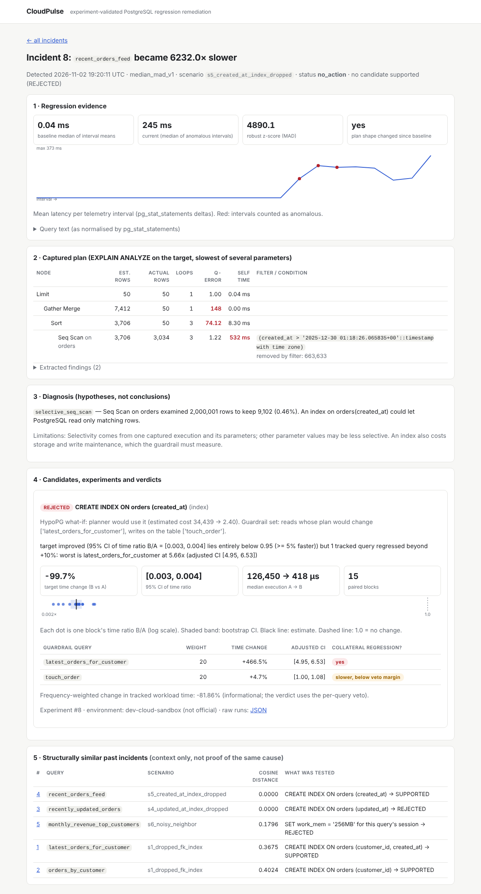
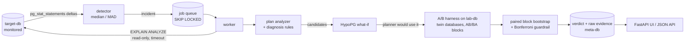

# CloudPulse

**Workload-aware, experiment-validated PostgreSQL query regression remediation.**

[](https://github.com/GTX-Pradeep/cloudpulse/actions/workflows/ci.yml)


When a query regresses, most tools stop at *"it's slow, maybe add an index."*
CloudPulse treats every suggested fix as a **hypothesis** and tests it:

```
Regression → Evidence → Diagnosis → Candidate fix → Controlled A/B experiment
          → Statistical verdict → Workload-wide guardrail
```

It detects the regression from `pg_stat_statements`, captures and analyses the
execution plan, proposes a small set of explainable fixes, and **benchmarks each
one on an identical copy of the database**, never on the monitored one. It then
answers three questions with evidence:

1. Did the fix make the target query faster, by how much, and how sure are we?
2. Did it make **any other tracked query** slower?
3. **SUPPORTED**, **REJECTED** or **INCONCLUSIVE**, and why?

## Headline result: a tempting index that CloudPulse rejects

Scenario S5: someone drops the index on `orders.created_at`, and the
recent-orders feed becomes ~4,700× slower. CloudPulse detects it, diagnoses a
selective sequential scan, and proposes re-creating the index. The lab
experiment confirms the index makes the feed **99.7% faster**
(95% CI of the time ratio [0.003, 0.004]).

But the guardrail also benchmarks every query whose plan HypoPG says would
change. With the index, PostgreSQL walks `created_at` backwards for
*"latest 10 orders of customer X"*, assuming that customer's orders are spread
evenly over time. For heavy customers whose orders are all old, that walk
reads most of the table:

| Customer | Without the index | With the index | |
|---|---:|---:|---:|
| 8 | 4.7 ms | 263.4 ms | 55.7× slower |
| 5 | 9.8 ms | 283.6 ms | 28.9× slower |
| 7 | 15.4 ms | 186.8 ms | 12.2× slower |
| 2 | 13.3 ms | 63.0 ms | 4.7× slower |
| 13 of the 30 sampled customers | | | faster |

`latest_orders_for_customer` is 5.66× slower overall (Bonferroni-adjusted CI
[4.95, 6.53]), so the verdict is **REJECTED**, with the reason written out. The
frequency-weighted workload time would still drop by 82%. CloudPulse reports
that number but deliberately does not let it override the veto: whether a 56×
slowdown for your biggest customers is acceptable is a human decision.



**How this result was reached honestly.** The first two evaluation runs
returned SUPPORTED for this candidate. The guardrail's parameter sample did not
contain the customers who suffer (F-7, then F-9 in the
[decision log](docs/decisions.md)). Both fixes, and both earlier results, are
committed.

## Results

> **Environment:** all numbers below come from the development sandbox
> (2 vCPU Intel Xeon @ 2.8 GHz, 7.8 GB RAM, **PostgreSQL 16.15**, Ubuntu 24.04)
> and are labelled `dev-cloud-sandbox (not official)` in every raw file. Dataset:
> 100,000 customers and 2,000,000 orders (seed 42). CI runs the tests on the
> pinned PostgreSQL 17 image. Reproduce on your own machine with
> `./scripts/reproduce.sh`.

### Ground-truth fault scenarios

Each scenario rebuilds the target, runs the tracked workload (9 query
templates, including an update) for 14 telemetry intervals, injects one known
fault, then runs 8 more intervals. Source: [`results/evaluation/20261102T185926Z`](results/evaluation/20261102T185926Z/summary.md)
plus two labelled supplementary runs.

| Scenario | Fault | Measured effect on its query | Detected | Diagnosis | Candidate → verdict |
|---|---|---:|---|---|---|
| S0 control | none | — | no alarms | — | — |
| S1 | index on `orders(customer_id)` dropped | 817× slower | 2nd interval after fault | `selective_seq_scan` ✅ | `CREATE INDEX (customer_id)` → **SUPPORTED**, −99.5% [0.005, 0.006], guardrail clean |
| S2 | 300k rows bulk-loaded, no `ANALYZE` | 1.83× | ❌ missed within 8 intervals; ✅ 9th interval in a 16-interval run¹ | `stale_statistics` ✅¹ | `ANALYZE orders` → **SUPPORTED**¹, −55% [0.43, 0.47], 6 guardrail queries clean |
| S3 | `work_mem` 64 MB → 4 MB | 1.03× (no real slowdown) | correctly silent | — | — |
| S4 | index on `orders(updated_at)` dropped | 2,635× | 3rd interval | `selective_seq_scan` ✅ | `CREATE INDEX (updated_at)` → **REJECTED**: target −99.6%, but `touch_order` updates **+23%** [+14.5%, +30.8%], consistent with losing HOT updates (manually verified: 100% → 0% HOT) |
| S5 | index on `orders(created_at)` dropped | 4,752× | 3rd interval | `selective_seq_scan` ✅ | `CREATE INDEX (created_at)` → **REJECTED**²: target −99.7%, `latest_orders_for_customer` **5.66× slower** |
| S6 | CPU/IO contention ("noisy neighbour") | 2 report queries flagged | n/a | no plan-level cause for the report | `work_mem 256MB` → **REJECTED** (+7.7%) · `CREATE INDEX (status)` → SUPPORTED (−67%)³ |

¹ Supplementary run with 16 post-fault intervals ([`…_supplementary-16-rounds`](results/evaluation/20261102T191456Z_supplementary-16-rounds/summary.md)).
Only one of the template's three parameter values regressed, so the interval
mean only crossed the threshold intermittently. This is the detector's known
parameter-mix weakness.
² After fix F-9 ([`…_supplementary-after-F9`](results/evaluation/20261102T191912Z_supplementary-after-F9/summary.md)).
The main run returned SUPPORTED because the guardrail never sampled an affected customer.
³ The status index genuinely speeds up that query in isolation, but it does not
address the actual cause (contention). A SUPPORTED verdict is about the
candidate, not a root-cause claim.

**Summary of the corrected main run**
- **False alarms: 0** in 954 query-intervals with no fault active.
- **Detection:** 3 of 4 faults that really slowed their query were caught within
  2–3 intervals; S2 needed 9. S3's fault had no measurable effect and was rightly ignored.
- **Diagnosis:** the expected rule fired for every detected scenario (4 / 4, including the S2 supplement).
- **Verdicts:** 2 tempting indexes vetoed for collateral damage (S4, S5), 1 memory
  change rejected as useless (S6), 4 candidates supported.
- **Run-to-run variation is real.** The superseded first run measured S4's write
  slowdown at +13% [+9%, +17%], which passed the 10% veto with a warning. The
  corrected run measured +23% and vetoed it. See F-5.

### Are the verdicts stable? (replication)
Every tested candidate was re-run 3 more times with fresh twin databases and new
shuffle seeds ([`results/replication`](results/replication/20261103T014630Z/summary.md)):

| Candidate | Verdicts over 4 runs | Consolidated |
|---|---|---|
| S5 `CREATE INDEX (created_at)` | REJECTED ×4 (collateral 4.4×–5.7× every run) | **REJECTED** |
| S2 `ANALYZE orders` | SUPPORTED ×4 (target 0.43–0.45) | **SUPPORTED** |
| S1 `CREATE INDEX (customer_id, created_at)` | SUPPORTED ×4 | **SUPPORTED** |
| S6 `CREATE INDEX (status)` / `work_mem 256MB` | SUPPORTED ×4 / REJECTED ×4 | **stable** |
| S4 `CREATE INDEX (updated_at)` | REJECTED ×1, SUPPORTED ×3 | **UNSTABLE** |
| S1 `CREATE INDEX (customer_id)` | SUPPORTED ×3, REJECTED ×1 | **UNSTABLE** |

The headline holds. The two unstable cases are informative: the UPDATE slowdown
caused by the extra index was **consistently +17% to +23%** in all four S4 runs, but
the lower end of its confidence interval sat right on the 10% veto line (1.09–1.15),
so the verdict flipped. The *effect* replicates; its *classification* does not.
CloudPulse now reports such candidates as UNSTABLE instead of picking a side
(D-023, F-11). Replication ran after the sandbox restarted on a 2.30 GHz host; each
results file records its own hardware.

### Is the measurement method trustworthy? (A/A calibration)
10 repeats × 5 queries with **identical** arms and fresh twin databases each time
([`results/calibration`](results/calibration/20261102T185543Z/summary.json)):

| | Result |
|---|---|
| False "SUPPORTED" verdicts | **0 / 50** |
| False collateral-regression flags | **0 / 50** |
| 95% CI contains 1.0 | 45 / 50 (90%, a little under nominal) |
| Largest A/A difference | 17.7% on the single-row UPDATE; reads ≤ 14.8%, 37 / 40 within ±8% |

The decision margins (5% for improvements, Bonferroni + 10% for harm) absorb this
noise, but single-run effects of ±10–15%, especially on writes, need replication.

### Similarity search (secondary)
On 30 hand-written queries in 6 structural families, the deterministic
structural vectors retrieve same-family queries with **recall@4 = 1.00**,
against 0.68 for a text-similarity (token Jaccard) baseline. The families were
written by the same author as the features, so this shows the features behave
as designed, not that they generalise.

### Mistakes found and fixed along the way
The [decision log](docs/decisions.md) records 12 of them, including:
- a `work_mem` hypothesis that measurement disproved (F-1);
- EXPLAIN buffer counters being inclusive of child nodes (F-2);
- psycopg splitting one query into several `pg_stat_statements` entries by integer size (F-4/D-019);
- two guardrail sampling gaps (F-7, F-9);
- a bookkeeping bug that produced fake false positives (F-8);
- verdicts that flip between runs when an effect sits on a decision margin (F-11);
- impossible "hotspot" shares in parallel plans, found while writing the guide (F-12).


## How it works



| Step | What it does | Why it is built this way |
|---|---|---|
| **Telemetry** | Snapshots cumulative `pg_stat_statements` counters and derives per-interval deltas | Resets, restarts and evictions invalidate an interval instead of producing a fake negative delta |
| **Detection** | Each query against *its own* history: median/MAD, ≥1.5× and z > 4, sustained 3 of 4 intervals | Fixed thresholds ("> 500 ms") are wrong for almost every query |
| **Plan evidence** | `EXPLAIN (ANALYZE, BUFFERS)` parsed into a typed tree: q-error, self time, spills, loops, plan fingerprint | Raw EXPLAIN output is not evidence until it is structured |
| **Diagnosis** | Seven explainable rules; every hypothesis stores its evidence **and its limitations** | "Why did you suggest this?" must always have an answer |
| **Candidates** | btree index (1–2 columns), `ANALYZE`, `work_mem` scoped to one session | A small, defensible space; no SQL rewriting, no global config changes |
| **HypoPG** | Skips candidates the planner would not use; finds which other queries (and which *parameter values*) would change plan | Cheap what-if planning, never treated as proof |
| **Experiment** | Two physically identical databases (`CREATE DATABASE … TEMPLATE`), candidate applied to one, blocks AB/BA, result-equivalence check | Same layout and statistics; drift hits both arms; "faster but wrong" is caught |
| **Verdict** | Log ratio of block totals, paired block bootstrap CI, decision rule fixed in advance | Three outcomes, including an honest INCONCLUSIVE |
| **Guardrail** | Every query whose plan may change plus every write on the table, Bonferroni-adjusted, +10% veto | A locally excellent index can be globally harmful |

More detail: [architecture](docs/architecture.md) ·
[decision log](docs/decisions.md) (every design choice, its alternatives, and **12 documented mistakes**) ·
[learning notes](docs/learn/).

## Quick start

Requirements: Docker with Compose v2, Python 3.11+.

```bash
git clone https://github.com/GTX-Pradeep/cloudpulse.git && cd cloudpulse
cp .env.example .env
docker compose up -d --build --wait        # target-db, lab-db, meta-db (PostgreSQL 17 + HypoPG + pgvector)
python3 -m venv .venv && source .venv/bin/activate
pip install -e ".[dev]"
pytest -q                                  # unit, golden-file and integration tests

cloudpulse bench experiments/ab_created_at_index_trap.json   # A/B + guardrail; dev sandbox gave REJECTED (5.21x collateral)
cloudpulse evaluate --scale small --scenario s5_created_at_index_dropped
cloudpulse serve                           # http://127.0.0.1:8000
```

Reproduce **everything** (tests, A/A calibration, full scenario suite) and label
the results with your machine: `./scripts/reproduce.sh` (`--quick` for a ~15 min run).

## Repository layout

```
src/cloudpulse/
  datagen/      deterministic skewed customers/orders data (seeded, generated in SQL)
  bench/        experiment specs, parameter samplers, twin-database A/B harness
  stats/        effect estimate, paired block bootstrap, decision rule
  workload/     tracked workload + fault scenarios, load generator, guardrail
  plans/        EXPLAIN JSON → typed tree, findings, fingerprints
  diagnosis/    rules → hypotheses → candidates; HypoPG what-if
  telemetry/    pg_stat_statements collector, regression detector
  meta/         evidence schema (constraints, partial unique index, delta view)
  jobs/         PostgreSQL job queue (SKIP LOCKED + leases) and worker
  similarity/   structural vectors, pgvector exact search, retrieval benchmark
  api/          FastAPI + server-rendered evidence UI
  pipeline.py   investigate → experiment orchestration
  evaluation.py ground-truth scenario suite;  calibration.py  A/A calibration
tests/          unit, simulation, golden-file (real EXPLAIN output), integration, API
experiments/    example A/A and A/B specs
results/        raw measurements behind every number in this README
docs/           architecture, decision log, learning notes
```

## Limitations (read before trusting a number)

- **The committed results come from a 2-vCPU cloud VM running PostgreSQL 16**,
  because the build sandbox could not pull the PostgreSQL 17 image. CI runs the
  test suite on the pinned PostgreSQL 17 image. Run `./scripts/reproduce.sh` for
  your own numbers.
- **The scenarios are synthetic and were written by the same author as the rules.**
  Detection and diagnosis scores show that the rules work on the faults they were
  designed for, not that they generalise. The experiment measurements are real
  PostgreSQL behaviour on this dataset and hardware.
- Single-run confidence intervals are somewhat optimistic on a noisy VM
  (90% A/A coverage for a nominal 95%). Decision margins absorb this, but small
  effects (±10–15%), especially on writes, need replication.
- The detector works on interval means, so a template whose parameters have very
  different costs can hide or delay a regression that affects only some values (S2).
- The lab rebuilds the target's state from a known generator plus scenario SQL. A
  real deployment would restore a snapshot.
- Not diagnosable: lock contention, I/O or CPU saturation, checkpoints, bloat,
  generic-plan flips. These end in "cause unclear" or in a REJECTED candidate (S6).
- Nothing is ever applied to the monitored database. A SUPPORTED verdict means
  "worth a human's review", not "safe in every production environment".

## License

MIT
