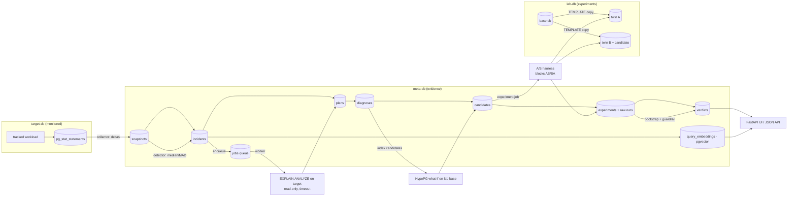

# Architecture

## Module map

| Package | Responsibility |
|---|---|
| `datagen` | deterministic skewed `customers` / `orders` data |
| `bench` | experiment specs, parameter samplers, the twin-database A/B harness, environment capture |
| `stats` | effect estimate, paired block bootstrap, verdict rule |
| `workload` | tracked workload and scenarios (`suite`), load generator, guardrail |
| `plans` | EXPLAIN JSON → typed tree, findings, fingerprints |
| `diagnosis` | rules → hypotheses → candidates; HypoPG what-if |
| `telemetry` | pg_stat_statements collector, regression detector |
| `meta` | evidence schema and data access |
| `jobs` | PostgreSQL job queue and worker |
| `pipeline` | orchestration of investigate and experiment steps |
| `similarity` | structural vectors, pgvector search, retrieval benchmark |
| `api` | FastAPI app and HTML templates |
| `evaluation`, `calibration` | ground-truth scenario suite, A/A calibration |

## Safety properties
- Experiments refuse to run against the target server (`db.assert_not_target`).
- Nothing is ever applied to the target automatically. A SUPPORTED verdict is
  marked "awaiting human review".
- Plan capture on the target runs reads in `READ ONLY` transactions with a
  statement timeout; writes are only `EXPLAIN`ed.
- Lab experiments are serialised by an advisory lock; twins are dropped in `finally`.
